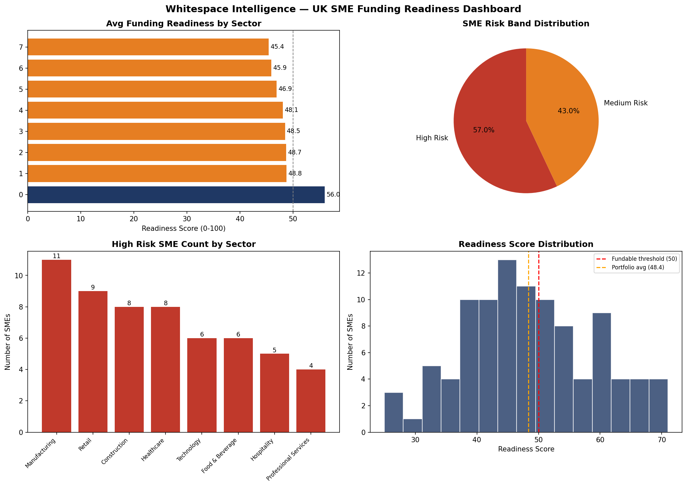

# Whitespace Intelligence — UK SME Funding Readiness Analysis

End-to-end data analytics project replicating the analytical engine behind **Whitespace Intelligence**, an AI-powered Funding Readiness Intelligence Platform for UK SMEs distributed through accountancy firms (B2B2B model).

Built using **Python, SQL, and Power BI** to analyse 100 UK SMEs across 8 sectors — identifying funding gaps, benchmarking sector performance, and producing CxO-ready conclusions.

---

## Dashboard Preview

---

## Business Problem

UK SMEs face a systemic funding gap. Many businesses that should qualify for funding are rejected due to poor presentation of their financial position rather than actual creditworthiness. Whitespace Intelligence solves this by:

- Scoring each SME against a standardised funding readiness framework
- Benchmarking them against sector peers
- Identifying high-readiness SMEs unfairly rejected by mainstream lenders
- Matching SMEs to the right lender for their risk profile

---

## What This Project Does

### 1. Data Generation (`project5.py`)
- Generates 100 realistic UK SME records across 8 sectors
- Sectors: Retail, Hospitality, Professional Services, Manufacturing, Technology, Construction, Healthcare, Food & Beverage
- Each SME has revenue, credit score, years trading, cash flow score, debt ratio
- Calculates a funding readiness score (0–100) using a weighted scoring engine
- Assigns risk band: Low / Medium / High / Very High Risk
- Aggregates a sector-level benchmark with CxO one-liner conclusions

### 2. SQL Analysis (`project5_sql.py`)
SQLite database (`whitespace_sme.db`) with 3 analytical queries:
- SMEs grouped by risk band with average readiness and revenue
- Worst-performing sectors by funding readiness
- Quick-win opportunities — borderline SMEs that need targeted coaching

### 3. Visualisation (`project5_charts.py`)
4-chart matplotlib dashboard:
- Average funding readiness by sector
- Risk band distribution (pie chart)
- High-risk SME count by sector
- Readiness score distribution histogram

### 4. CxO Reporting (`project5_excel.py`)
Full Excel report with 3 sheets:
- **Executive Summary** — KPIs, sector conclusions, embedded chart
- **SME Data** — Full record-level dataset with risk-band colour coding
- **Sector Benchmark** — Sector-by-sector aggregation

### 5. Interactive Dashboard (`whitespace_dashboard.pbix`)
Power BI dashboard with:
- 4 KPI cards — Total SMEs, Avg Readiness, Total Revenue, High Risk Count
- Average readiness by sector (bar chart)
- Risk band distribution (pie chart)
- Sector slicer for interactive filtering

---

## Key Insights

- 57% of UK SMEs analysed fall below the fundable readiness threshold
- Professional Services performs strongest; Food & Beverage and Retail are at highest risk
- Cash flow score is the single biggest differentiator between funded and unfunded SMEs
- A material number of SMEs with strong credit scores are rejected due to poor cash flow presentation — exactly the gap Whitespace Intelligence is built to close

---

## Tech Stack

- **Python 3.13** — pandas, numpy, matplotlib, openpyxl
- **SQL** — SQLite via Python sqlite3
- **Power BI Desktop** — Interactive CxO dashboard
- **VS Code** — Development environment
- **GitHub** — Version control

---

## Files in This Repository

| File | Purpose |
|------|---------|
| `project5.py` | Data generation, scoring, benchmarking, CSV export |
| `project5_charts.py` | 4-chart dashboard PNG |
| `project5_excel.py` | Full CxO Excel report with 3 sheets |
| `whitespace_sme_data.csv` | 100 SME records (cleaned data) |
| `whitespace_benchmark.csv` | Sector-level benchmark |
| `whitespace_sme.db` | SQLite database |
| `whitespace_dashboard.pbix` | Power BI interactive dashboard |
| `whitespace_dashboard.png` | Static 4-chart dashboard |
| `Whitespace_SME_Funding_Report.xlsx` | Full CxO Excel report |

---

## About the Author

**Prajwal Shet** — Finance professional with 6+ years of UK/UAE/India experience across audit, accounting, and FP&A. Founder of Whitespace Intelligence.

- Email: 09prajwalshet@gmail.com
- GitHub: [@prajwal-shet-fpa-ai](https://github.com/prajwal-shet-fpa-ai)
